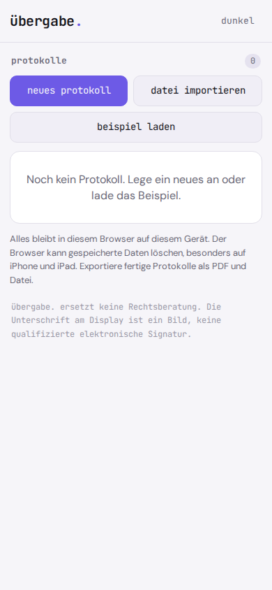
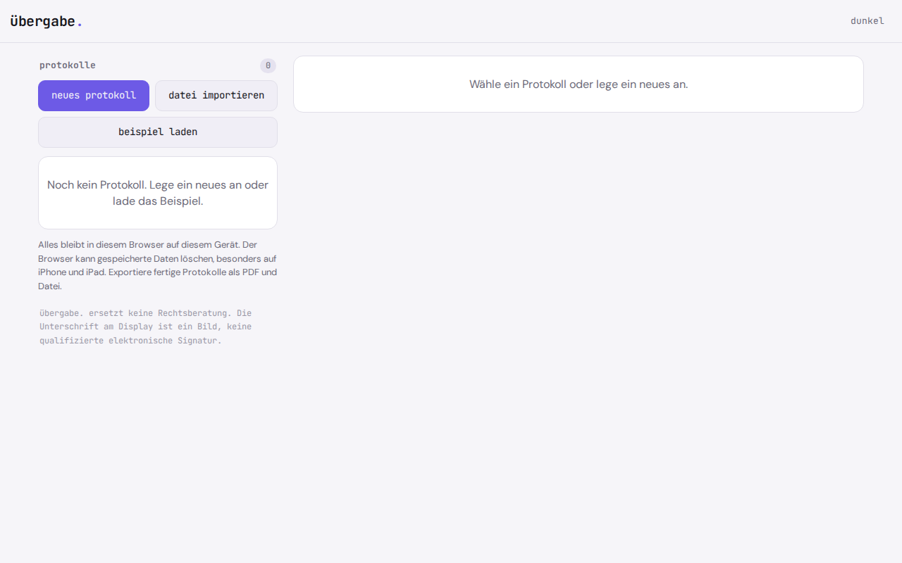

# übergabe.

**Record an apartment handover on your phone.** Rooms, defects, photos, meter readings, keys, signatures, PDF.

übergabe. is a move-in and move-out inspection checklist (in German: Wohnungsübergabeprotokoll) for tenants and private landlords. It runs offline in the browser as a PWA, needs no account and keeps everything on your phone.

   

**Try it:** https://gedachtgemacht.github.io/uebergabe/ (works in any phone browser, install via "Add to Home Screen")

The app interface is in German.

Every move-in and move-out needs a handover report. If you want to do it digitally, you end up with apps that are part of landlord software, require an account, upload data to someone else's server, or charge per report or by subscription. The alternative is a printed template, with the photos lying loose on your phone. übergabe. runs offline in the browser, attaches photos directly to the defect, is signed by both sides on the same device, and goes out as a PDF and a file.

Plain logic, no AI, no server. Everything stays on your phone.

<p align="center">
  
</p>

<p align="center">
  
</p>

## Why

Handover apps exist, but they belong to landlord platforms (account required, price on request) or charge per report or by subscription, some with a cloud. übergabe. does the core of it: free, no account, no server, in the browser on any phone. It does not replace property management software: no sending, no tenant management, no template library.

## Features

- **Reports:** create reports, list of all reports, duplicate a report (prepare the move-out from the move-in; defects then count as pre-existing)
- **Header:** move-in or move-out, date and time, address, location of the flat, landlord, tenant, other people present
- **Rooms** with suggestions (hallway, kitchen, bathroom, living room, bedroom, balcony, cellar), add your own, rename, reorder
- **Defects** per room with description, location, severity (minor, moderate, serious), a note whether it was already there at move-in or is new, up to 6 photos per defect (camera or gallery)
- **Meters:** type, meter number, reading, unit, photo of the reading
- **Keys** with type, count and a note; the total is shown
- **Agreements** as free text
- **Signatures** from both sides one after the other with a finger on the same device, each with a name. A checksum is calculated and shown first. After the first signature the report is locked; changing it means discarding the signatures
- **PDF** created locally, with all details, photos, signatures and the checksum. Share it through the system share sheet or download it
- **Export and import** as a file (`.uebergabe.json`, photos embedded)
- **Sample report**, marked as `Beispiel` ("example") and removable with one click
- Light and dark mode, works offline, installable as an app

## Privacy

Nothing leaves your device. übergabe. has no server, no account, no analytics, no ads and loads nothing from the network, not even fonts. Reports and photos are stored only in your browser's local database (IndexedDB), the light or dark choice in local storage. PDFs and files are only created when you trigger them yourself.

Because the data lives only in the browser: if you clear the site data, the reports are gone too. Browsers can also clear storage on their own, especially on iPhone and iPad. übergabe. asks the browser for persistent storage; whether it grants it is up to the browser. So export finished reports as PDF and as a file.

## Install

übergabe. is a static web app. There is no build step and there are no dependencies.

1. Put the folder on any static host (your own web space, GitHub Pages, Netlify, a Raspberry Pi). Installing it as an app needs HTTPS.
2. Open the address in your phone's browser.
3. In the browser menu choose **Zum Startbildschirm hinzufügen** ("Add to Home Screen"). After that übergabe. starts like an app and also works without a network.

Test locally:

```
python3 -m http.server 8000
```

Then open `http://localhost:8000` in your browser.

## How it works

There is no cost or consumption calculation here. The logic lives in pure functions (`logik.js`, `pdf.js`) that run without a DOM and are tested with `node test-calc.js` against hand calculations and test vectors.

- **Numbers:** German notation, dot as thousands separator, comma as decimal separator. `12.345,6` becomes `12345.6`, `12,3,4` is rejected.
- **Photos:** scaled down on capture to at most 1600 px on the long edge (never scaled up), JPEG at quality 0.75.
- **Checksum:** SHA-256 over the content as JSON with sorted keys, without signatures, `id` and the example marker. Photos go in as their own SHA-256. The PDF shows the first 16 characters in groups of four. The same content in a different key order gives the same checksum; a changed meter reading gives a different one. The built-in SHA-256 is tested against the standard test vectors.
- **PDF:** a small custom writer, no library. A4, Helvetica with the WinAnsi character set (characters outside it become `?`), photos as JPEG, signatures as vector paths, `xref` offsets checked in the tests. Example: "Bad" in 10 pt is (667 + 556 + 556) ÷ 1000 × 10 = 17.79 pt wide.

## Limits

- The on-screen signature is an image, **not a qualified electronic signature**. The checksum only helps to show that the PDF and the file belong together.
- No legal advice, no judgment on who is responsible for a defect, no deposit settlement, no utility billing.
- No sending by email, no sync between devices, no photo editor, no floor plans.
- Taking photos goes through the browser's file input and behaves differently depending on the browser; the gallery always works as a fallback.
- Many photos make the PDF and the file large; from 50 photos on the app points this out.
- The tests check the logic and the PDF structure. Whether the PDF opens in every viewer has not been checked on all devices.

## License

GNU Affero General Public License v3.0 (AGPL-3.0), see `LICENSE`.

**Deutsch:** übergabe. ist ein Übergabeprotokoll für Wohnungsübergabe bei Einzug und Auszug am Handy, mit Mängeln, Fotos, Zählerständen, Schlüsseln, Unterschrift und PDF, offline und ohne Konto.

---

**gedacht.gemacht.** Small, honest software. Everything stays on your device. · [More projects](https://github.com/gedachtgemacht)
